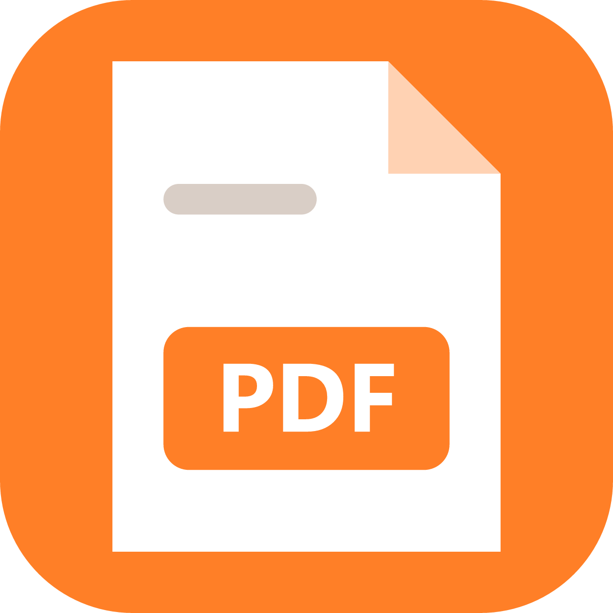

<div align="center">
  
  <h1>PdfViewer</h1>
  <p>가볍고 빠른 PDF 뷰어 · 페이지 편집 · 병합 · Markdown 내보내기</p>
</div>

<p align="center">
  
  
  
  
</p>

---

## 📦 소개

**PdfViewer**는 PDF를 보고, 페이지를 정리하고, 여러 파일을 합칠 수 있는 데스크톱 앱입니다.
편집·변환 도구는 버튼을 누를 때만 불러오기 때문에 평소에는 가볍고 빠르게 동작합니다.
모든 작업은 PC 안에서만 이루어지며, 파일을 외부로 보내지 않습니다.

상단 메뉴: **열기** · **인쇄** · **MD 내보내기** · **페이지 편집** · **PDF 병합**

### PDF 열기

- 상단의 **열기** 버튼을 누르고 PDF를 고르면 바로 화면에 표시됩니다.
- PDF 파일을 창에 **끌어다 놓아도** 열립니다.
- PdfViewer를 PDF 기본 앱으로 지정하면 탐색기에서 **더블클릭**으로 열 수 있습니다.
- 파일은 원래 위치에서 그대로 읽으며, 다른 폴더로 복사하지 않습니다.
- 확대/축소, 페이지 이동, 검색, 저장은 내장 PDF 뷰어 도구 모음을 사용합니다.
- **인쇄** 버튼으로 지금 보고 있는 PDF를 바로 인쇄할 수 있습니다.

### 페이지 편집

PDF를 연 뒤 **페이지 편집**을 누르면 페이지 썸네일이 바둑판처럼 나오는 편집 화면이 열립니다.

| 작업 | 방법 |
| --- | --- |
| 선택 | 클릭 · Ctrl+클릭(여러 개) · Shift+클릭(범위) · Ctrl+A(전체) |
| 순서 바꾸기 | 썸네일을 끌어다 원하는 위치에 놓기 |
| 회전 | ↺ / ↻ 회전 버튼, 또는 우클릭 메뉴 (90°씩) |
| 삭제 | 삭제 버튼 · Delete 키 · 우클릭 메뉴 |
| 다른 PDF 끼워넣기 | PDF 끼워넣기 버튼, 또는 우클릭 메뉴의 "앞에/뒤에 PDF 끼워넣기" |
| 선택 페이지 추출 | 선택 추출 버튼 · 우클릭 메뉴 → `파일명_추출.pdf`로 저장 |

- 썸네일을 **우클릭**하면 회전·삭제·끼워넣기·추출 메뉴가 나옵니다.
- **다른 이름으로 저장**을 누르면 원본은 그대로 두고 새 파일(`파일명_편집.pdf`)로 저장한 뒤 바로 화면에 엽니다.
- 저장하지 않고 닫으려 하면 한 번 더 확인합니다. 암호가 걸린 PDF는 편집할 수 없습니다.

### PDF 병합

- **PDF 병합**을 누르고 PDF를 2개 이상(Ctrl·Shift로 여러 개) 고르면, 모든 페이지가 이어진 편집 화면이 열립니다.
- 순서를 바꾸거나 필요 없는 페이지를 지운 뒤 저장하면 `파일명_병합.pdf`가 만들어집니다.

### Markdown으로 내보내기

- PDF를 연 뒤 **MD 내보내기**를 누르면 글자를 Markdown(`.md`) 파일로 저장합니다.
- 글자 크기로 제목(`#`, `##`, `###`)을 구분하고, 줄바꿈된 문장은 문단으로 이어 붙입니다.
- 두 단으로 편집된 문서는 왼쪽 단 → 오른쪽 단 순서로 읽고, 반복되는 머리글·쪽 번호는 지웁니다.
- 글자가 없는 스캔 이미지 PDF는 내보낼 수 없습니다. 표는 표 모양 없이 한 행씩 글자로 나옵니다.

---

## 🧰 사용 기술

| 기술                       | 용도                     |
| -------------------------- | ------------------------ |
| Tauri 2                    | 데스크톱 앱 셸           |
| TypeScript + Vite          | 화면 로직 및 번들링      |
| Rust                       | PDF 읽기, PDF·MD 파일 저장 |
| @tauri-apps/plugin-dialog  | 파일 열기·저장·확인 창   |
| pdfjs-dist (PDF.js)        | 썸네일 그리기, MD 내보내기용 글자 추출 |
| pdf-lib                    | 페이지 편집·병합·추출 후 새 PDF 만들기 |

---

## 📁 프로젝트 구조

```plaintext
📁 pdfviewer
├── index.html                → 화면 구성과 스타일
├── app-icon.svg              → 앱 아이콘 원본
├── 📁 public/cmaps/          → 한글 글꼴 매핑 자료 (MD 내보내기용)
├── 📁 src/
│   ├── main.ts               → 상단 메뉴, 열기·끌어다 놓기·인쇄·내보내기
│   ├── pageEditor.ts         → 페이지 편집·병합 화면, 우클릭 메뉴
│   ├── pdfjs.ts              → PDF.js 불러오기 (필요할 때 한 번만)
│   └── pdfToMarkdown.ts      → PDF 글자를 Markdown으로 변환
└── 📁 src-tauri/
    ├── src/main.rs           → PDF 읽기, 실행 인자 처리, PDF·MD 저장 커맨드
    ├── capabilities/         → 권한 설정
    └── tauri.conf.json       → 창 크기, 번들 설정
```

---

## 🚀 실행 방법

### 준비물

- Node.js 18 이상
- Rust 툴체인 (cargo)
- [Tauri 사전 요구사항](https://tauri.app/start/prerequisites/)

### 개발 모드로 실행

```bash
git clone https://github.com/biggsman/pdfviewer.git
cd pdfviewer
npm install
npm run tauri dev
```

---

## 🏗️ 빌드

```bash
npm run tauri build
```

| 결과물              | 위치                                                              |
| ------------------- | ----------------------------------------------------------------- |
| 실행 파일           | `src-tauri/target/release/pdfviewer.exe`                          |
| Windows 설치 (.msi) | `src-tauri/target/release/bundle/msi/pdfviewer_0.4.1_x64_en-US.msi` |
| Windows 설치 (.exe) | `src-tauri/target/release/bundle/nsis/pdfviewer_0.4.1_x64-setup.exe` |
| Linux 설치 (.deb)   | `src-tauri/target/release/bundle/deb/pdfviewer_0.4.1_amd64.deb`   |

> Linux에서 빌드하려면 `libwebkit2gtk` 등 Tauri 사전 요구사항이 설치되어 있어야 합니다.

---

## 🙏 출처

이 프로젝트는 [taberkkaya/PdfViewer](https://github.com/taberkkaya/PdfViewer)를 바탕으로 기능을 단순화해 만들었습니다.
